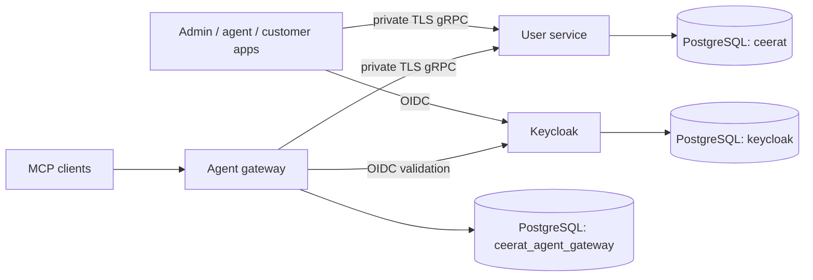
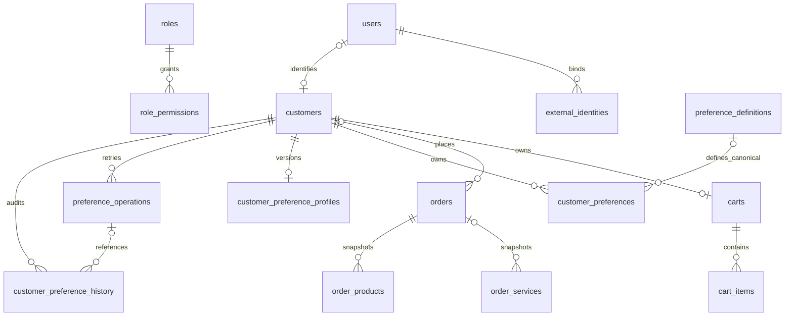

# CEERAT database architecture

Reference date: 2026-10-08. Read this with the [object model catalog](database-object-models.md), [HTML schema reference](database-schema.html), and [operations runbook](database-create-restore.md). The catalog was verified against the local database after all 17 application migrations; hosted verification is recorded separately.

## Ownership and connections

One PostgreSQL database holds three separately owned schemas. Schemas are an ownership convention; the shared database role in the current Blueprint does not provide independent security isolation. Use separate roles/grants when enforcing access boundaries.

| Schema | Owner | Contents and lifecycle |
|---|---|---|
| `ceerat` on Render; `public` in the existing local setup | User service | Identity, RBAC, customers, catalog, commerce, careers, AI/calendar, preferences, migration ledger. Empty-schema bootstrap followed by explicit ordered SQL migrations; runtime performs preflight, not AutoMigrate. |
| `keycloak` | Keycloak | Realms, identities, credentials, clients, sessions, roles and federation state. Keycloak manages its own schema upgrades. Never apply user-service migrations here. |
| `ceerat_agent_gateway` | Agent gateway | Connections, preparations, cart-clear/checkout/order-mutation previews and rate limits. Current gateway startup executes schema statements and expiry cleanup in `internal/gateway/state.go`; this is separate from the user-service migration ledger. |

Render consumers use the same-region internal hostname; operator workstations use the external hostname with TLS. Browser/MCP clients never receive database credentials. `render.yaml` declares the existing `ceerat-postgres` instance and the schema environment for each consumer. Local configuration comes from `infra/common.sh` and the uncommitted `.env`; local helpers must not inherit hosted targets.

## Domain and object models

The [catalog](database-object-models.md) maps every local application table to its Go model or SQL record and lists all 543 columns, defaults, nullability, physical constraints and indexes. Actual FK declarations are distinguished from application-level associations there; a field named `customer_id` does not itself prove a FK exists.

| Domain | Principal objects | Relationship and invariants |
|---|---|---|
| Identity and authorization | `users`, `external_identities`, `roles`, `role_permissions` | OAuth issuer/subject binds an external identity to a user; email alone never links accounts. Users carry status and role names. Role permissions map roles to gRPC methods; `users.role` is not a role FK. OAuth-only password may be NULL. |
| Customers | `customers`, `customer_services` | Customer profile belongs to a user; user association is unique when populated. Customer/service assignment joins customers to the service catalog. Owned reads include customer predicates. |
| Catalog | `services`, `product_variants`, `product_categories`, `product_category_assignments`, `catalog_images`, `catalog_image_contents`, `catalog_discounts` | `services` stores services and products; variants/categories/images/discounts refer to catalog objects. Image bytes live separately from metadata. Version checks support conditional writes. |
| Cart | `carts`, `cart_items`, `cart_idempotency_keys` | One cart per customer; items select services/products and optional variants. Cart version and idempotency records protect mutation retries. Money uses integer minor units and currency. |
| Orders | `orders`, `order_services`, `order_products`, `order_pricing_rules`, `order_operations`, `payment_sessions` | Orders retain line/pricing snapshots and exact-money totals. Operations retain preview/reconciliation state. Payment sessions keep provider references and bounded lifecycle status. Order numbers use a sequence-backed allocator. |
| Career catalog | `companies`, `jobs`, `skills` | Jobs belong to companies; skills provide the vocabulary for profiles. |
| Career profiles | `skill_profiles`, `skill_profile_skills`, `resumes`, `employment_records`, `resume_employment_records` | Skill profiles link skills; resumes link profiles and employment records. Some customer ownership links are application-level rather than physical FKs; consult the catalog. |
| Career workflows | `job_carts`, `job_cart_items`, `job_applications`, `job_application_submissions` | Saved jobs and application/submission records prevent duplicate customer/job combinations with unique keys. Selected profiles/resumes provide application sources. |
| Metrics | `career_market_metrics`, `customer_career_metrics` | Dated market and customer aggregates; metric uniqueness is scoped by identity/date. |
| AI and calendar | `ai_threads`, `ai_thread_messages`, `calendar_events` | Threads/messages preserve user ownership; message deletion cascades with its thread. Calendar events belong to customers. AI metadata is separate from the closed typed preference value model. |
| Preferences | `preference_definitions`, `customer_preferences`, `customer_preference_profiles`, `preference_operations`, `customer_preference_history` | Server-owned definitions bind typed customer values/scopes. Profile versions serialize mutations, operations preserve retry outcomes, history retains digests. |
| Schema control | `schema_migrations`, `schema_migration_lock` | Applied version/filename/SHA-256/time ledger plus a single migration lease. These restore with the database. |

The diagram shows core relationships; optional user/customer links and custom preferences account for nullable associations. The physical FK inventory in the catalog is authoritative for deletion behavior. History deliberately keeps a preference identifier without requiring the preference row to survive deletion.

## Preference persistence rules

Exactly one of text, boolean, integer, decimal, money, option or option-list is present. NULL differs from false/zero. Decimal strings are canonical and bounded; USD money is a nonnegative `bigint` minor-unit amount. Scopes are global, context or entity with mutually exclusive bounded labels. No arbitrary request JSON, OAuth token, prompt or Exchange Data enters preference tables.

Canonical records reference an enabled/current definition for new writes. Custom records have no definition and use definition version zero. Reviewed definitions seed without overwriting operator edits. Existing valid older display/version snapshots remain readable. SQL checks, a catalog trigger and Go read/write hooks enforce shape and bounds. TXSE settings use reviewed options and instrument/watchlist references; environment, entitlement and classification authority are rejected.

Logical uniqueness is `(customer_id,preference_key,scope_kind,context_key,entity_type,entity_id)`. Operation keys are unique on `(customer_id,idempotency_key)` across operation kinds. Lock order is profile → logical preference → operation/history. Read pagination is customer-first with `(updated_at DESC,id DESC)`. Trusted bounded housekeeping removes elapsed history before unreferenced terminal operations and retains unresolved outcomes.

## Schema evolution and recovery

The empty-schema `dbbootstrap` model set is pinned to the service release. Afterwards the ordered migration ledger governs evolution. Existing schemas never bootstrap. Runtime preflight checks required constraints, FK ownership, logical uniqueness, pagination, triggers and validator lookup. A successful process start is not a replacement for deployment preflight.

The latest required versions are `20261007` (preference hardening) and `20261008` (restore-safe validator lookup). These are sortable migration identifiers, not deployment dates. The second pins stored function `search_path` to `pg_catalog` and its owning schema so a logical restore can evaluate constraints with the caller path cleared. Applied files are immutable; repairs add later migrations.

The runner's lease lasts 15 minutes without renewal; coordinate longer migrations
so another runner cannot begin after expiry. Back up the entire database so application, Keycloak, gateway and schema ledger share a consistent snapshot. Migrations recreate structure and reviewed seed metadata, not business data. Logical backups omit role ownership/grants with `--no-owner --no-acl`; restore must re-establish approved roles/grants and service secrets separately. Provider PITR and encrypted logical exports have different recovery limits; the [runbook](database-create-restore.md) covers both.

## Source references

- `services-repo/services/ceerat-user-service/cmd/dbbootstrap/main.go`: pinned empty-schema models.
- `services-repo/services/ceerat-user-service/internal/models/models.go`: Go persistence entities.
- `services-repo/services/ceerat-user-service/preferences/`: typed row models, validators, repositories and lock/cleanup rules.
- `services-repo/services/ceerat-user-service/migrations/`: ordered schema, seed, repair and development rollback SQL.
- `services-repo/services/ceerat-user-service/scripts/db-*.sh` and `Makefile`: bootstrap guard, ledger, preflight, status and verification routines.
- `apps-repo/ai/ceerat-agent-gateway/internal/gateway/state.go`: gateway-owned state schema.
- `infra/render.yaml`: hosted database wiring and deployment commands.

PR05 adds `preference_operations.result_sealed bytea` with a validated size/state
constraint. Completed mutation snapshots use authenticated encryption, tied to
customer/operation, and persist for 30 days even after the active preference is
changed/deleted. History and idempotency/request keys are keyed digests, not raw
content. Restoring replay requires the retained shared service secret separately
from the SQL backup. See the user-service preference module for supported custom
personal schemas, reconciliation and trusted cleanup.
